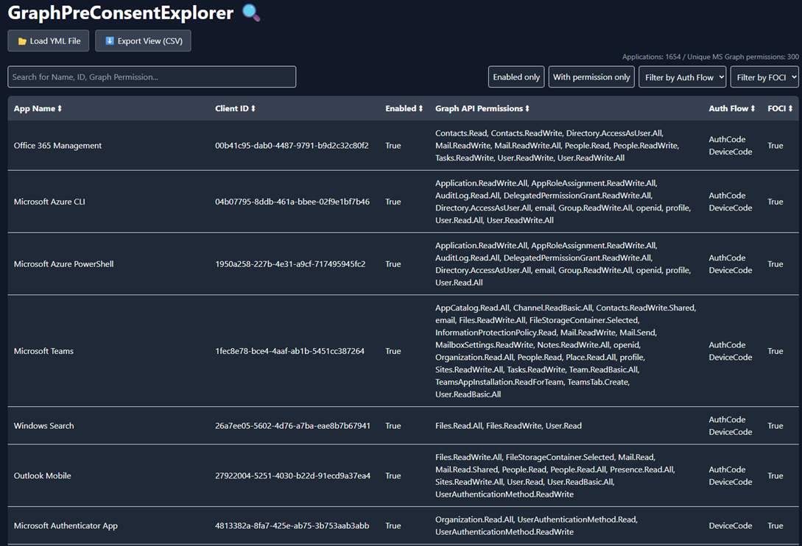
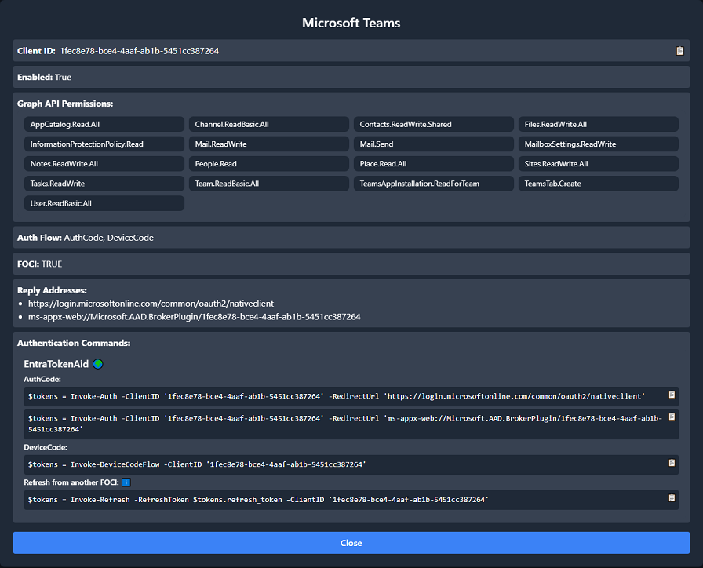
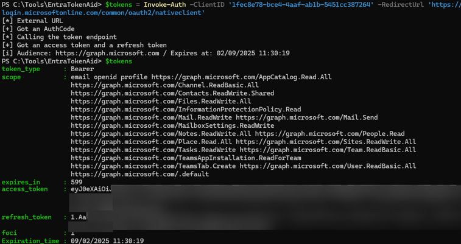

# GraphPreConsentExplorer 🔍

During security assessments, I often rely on various pre-consented scopes for the Microsoft Graph API. To use these scopes, I need to know which Client IDs have specific pre-consented scopes on the Graph API. Additionally, as more organizations restrict the Device Code Flow, it is crucial to identify which clients allow authentication via the OAuth Code Flow. This requires knowing which clients support different authentication methods, including:
- Device Code Flow
- OAuth Code Flow
- Special Refresh Flows (FOCI / BROCI)

To address this, I used [EntraTokenAid](https://github.com/zh54321/EntraTokenAid) to perform thousands of authentication attempts using ~1600 first party clients. This process helped identify which clients work with specific authentication flows and their corresponding pre-consented scopes on the Microsoft Graph API.

The result is a fairly large list of 368 Client IDs that have pre-consented scopes on the Graph API and can be used to authenticate without a client secret.  
All the information is stored in a YAML file, and there is a simple HTML GUI for easy search and filter navigation. It also provides easy copy-and-paste authentication commands for use with [EntraTokenAid](https://github.com/zh54321/EntraTokenAid).

If you know of additional first-party clients or authentication methods, feel free to contribute!  
Note: The goal is not to list every valid redirect URL, but to have at least one usable example for each client.

## 🚀 Features

**Data:**
- Around 1664 clients
- Around 368 clients with usable pre-consented scopes for the Microsoft Graph API
- Around 342 unique pre-consented scopes
- Total 49 FOCI clients


**GUI**:
- Load and visualize Entra ID first party clients from YAML files
- Display pre-consented Graph API scopes assigned to each application
- Filter, search and sorting capabilities (by name, client ID, FOCI, Auth Flow, etc.)
- Runs 100% locally in your browser
- Export the visible data
- [EntraTokenAid](https://github.com/zh54321/EntraTokenAid) authentication command generator (OAuth, Device Code, BroCi, etc.)
- No external dependencies (All local, simple HTML + JavaScript)


## 📷 Screenshots
Main table:



Detail view of the app. Includes copy and paste authentication commands:  


Usage of the copy and paste commands to use with [EntraTokenAid](https://github.com/zh54321/EntraTokenAid):  


## 📥 Installation


### Clone the Repository
```bash
git clone https://github.com/zh54321/GraphPreConsentExplorer.git
```

## 📌 Usage
1. **Open the HTML File**
2. **Load a YAML File:** Click on `📂 Load YML File` to load the YAML file.


## 📖 YAML Format
```yaml
apps:
  - name: "App One"
    client_id: "1234-5678-9101"
    enabled: "True"
    graph_api_permissions: ["User.Read", "Directory.Read.All"]
    auth_code: "True"
    device_code: "True"
    broci: "True"
    foci: "True"
    reply_addresses:
      - "https://whatever/callback"
    single_page_app: "True"
    notes: "This property is optional"
```


## 📝 Changelog

### 2026-03-20

UI/UX
- Search matches in the main table are now gently highlighted.
- The search field now supports boolean expressions with `&&`, `||`, and parentheses.
- A small inline `x` button was added to clear the current search quickly.

Client list
- Added a few additional first-party clients.
- Added more ReplyURLs and fixed so SPA flags
- Updated pre-consented permissions for all apps

### 2025-11-26

Client list
- Added 96 additional first-party clients.
- Added more ReplyURLs, allowing additional existing clients to work with the Auth Code Flow.
- Updated pre-consented permissions for some apps.

Fixed
- Updated the AuthCode command to use `http://localhost:13824/` instead of `http://localhost` to match the EntraTokenAid’s default port.

UI/UX
- Renamed the term *BRK-Refresh* to *BroCi* to align with industry standards 😉
- The details modal can now be closed by pressing `ESC`.
- The search field can now be focused by typing `/`.
- The currently visible data can now be exported as a CSV file.

YAML/CSV/JSON
- Standardized the YAML format: using `broci` consistently and `true` als value instead of `yes`.


### 2025-03-26
Client list:
- Added 98 first-party clients. However, no usable pre-consents on MS Graph were identified (some apps lack pre-consent, while others are confidential clients).

Misc:
- Added a new folder `lists` which contains the data as CSV and JSON file as well.

### 2025-03-01
Client list:
- Added approximately 31 first-party clients. However, no usable pre-consents on MS Graph were identified (some apps lack pre-consent, while others are confidential clients).

### 2025-02-12
Data structure:
- Added the *single_page_app* property for SPA applications, as they require the -origin parameter for authentication.

Client list:
- Added approximately 100 clients:
  - The total number of clients with pre-consented MS Graph scopes is now around 265.
  - In total there are now 50 FOCI clients (enabled). 

Credits: Many of the additional clients were sourced from Dirk-Jan’s [ROADTools](https://github.com/dirkjanm/ROADtools).


## 🙏 Credits & References 
- [Microsoft Entra First-Party App Scopes JSON](https://github.com/dirkjanm/ROADtools/blob/master/roadtx/roadtools/roadtx/firstpartyscopes.json) (by Dirk-jan Mollema)
- Check out https://entrascopes.com/ (by Fabian Bader and Dirk-jan Mollema), which includes additional pre-consented permissions beyond those in the Microsoft Graph API.
- [Going for Broke(ring) – Offensive Walkthrough for Nested App Authentication](https://specterops.io/blog/2025/08/13/going-for-brokering-offensive-walkthrough-for-nested-app-authentication/) (by Hope Walker)
- [NAA or BroCI…? Let Me Explain](https://specterops.io/blog/2025/10/15/naa-or-broci-let-me-explain/) (by Hope Walker)

